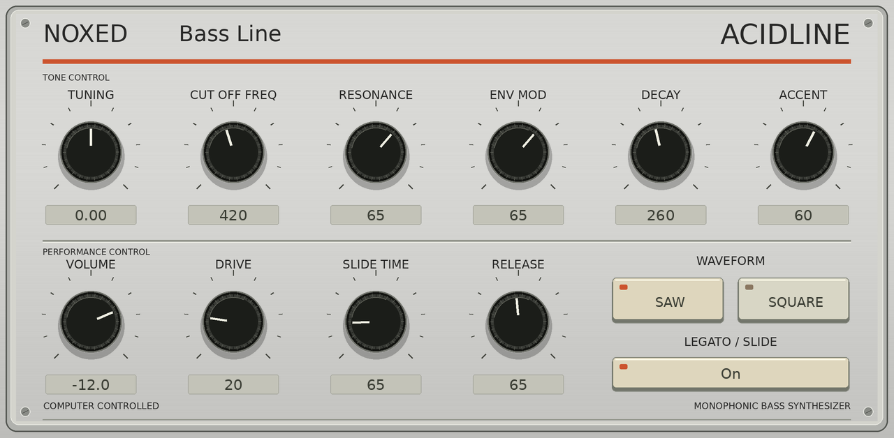

# NOXED MPC Plugins

[](https://github.com/molgino/noxend-mpc-plugins/actions/workflows/build-plugins.yml) [](https://ko-fi.com/noxend)

Open-source plugins for Akai MPC standalone (MPC Live/X/One/Key/Force, MPC OS 3.10.1+), built with the
[inMusic MPC Plugin Builder SDK](https://github.com/inmusic-software/mpc-plugin-builder-sdk):
two instruments and three bridges to external hardware. **Contributions are very welcome**, see [Contributing](#contributing).

**Acidline 0.3.0 · Prism Wave 0.1.4 · MPC Overwitch 0.5.1 · MPC Overwitch Send 0.5.1 · MPC USB Bridge 0.2.2.**
Acidline, Prism Wave and MPC Overwitch have been tried on an MPC Live III; plugins marked *preview* have not had every feature checked on hardware yet (details in each plugin's README).

> **How this was made:** these plugins are vibecoded. They were built with an AI coding assistant (Claude) and tested on real hardware by the author. The code is all here; reviews and fixes from people who know DSP, USB audio or C++ are very welcome.




Previews rendered from the actual skin files and knob graphics, not photos of the MPC screen.
More Prism Wave pages: [Filter/FX](docs/screenshots/prism-wave-filter.png) · [Envelopes](docs/screenshots/prism-wave-env.png) · [LFOs](docs/screenshots/prism-wave-lfo.png) · [Matrix](docs/screenshots/prism-wave-matrix.png).

## Plugins

| Plugin | What it does |
| --- | --- |
| **Acidline** | Monophonic, TB-303-inspired acid synth with saw/square, non-linear resonant filter, velocity accent, legato slide, drive, six presets, optional Open303 sound model and a switchable 16-step sequencer. [README](plugins/Acidline/README.md) |
| **Prism Wave** | Original, Serum-inspired wavetable synth: eight voices, two oscillators with up to three unison voices each, sub/noise, filter, two ADSRs, two LFOs, four modulation routes, chorus, delay and eight presets. [README](plugins/Prism%20Wave/README.md) |
| **MPC Overwitch** *(preview)* | Overbridge for Elektron devices (tested with Digitone II) directly on the MPC, based on Overwitch (GPL-3): device tracks as plugin tracks, up to 16 at once, groups of several outputs, MIDI to the device, 48 → 44.1 kHz with drift correction. [README](plugins/MPC%20Overwitch/README.md) |
| **MPC Overwitch Send** *(preview, effect)* | Sends MPC tracks over Overbridge into the Elektron device's inputs (Digitone II: Main, Delay, Reverb, Chorus). [README](plugins/MPC%20Overwitch%20Send/README.md) |
| **MPC USB Bridge** *(preview)* | Brings a class-compliant USB audio device that the MPC does not use as its interface (Roland S-1 first) in as a plugin track, with drift correction and MIDI to the device. [README](plugins/MPC%20USB%20Bridge/README.md) |

Acidline is not a circuit-accurate TB-303 emulation and Prism Wave is not a full Serum 2 clone.
No proprietary Roland or Xfer code, samples or presets are included.
Prism Wave has no Serum preset import, sample/granular mode, MPE or graphical wavetable editor.

## Download and installation

Ready-made packages are under **[Releases](../../releases/latest)**: one zip per plugin (`<plugin>-<version>-mpc.zip`) and a combined package `NOXED-MPC-Plugins-<version>.zip`. Every push also builds the plugins in [GitHub Actions](../../actions) (downloads under *Artifacts*).

1. Unzip on your computer.
2. Copy the plugin folder (`NOXED - VST - …`) into the `VST2 Plugins` folder at the root of an MPC drive (create it if it does not exist). Do not rename the folder.
3. Use **MPC OS 3.10.1 or newer** and switch on **Enable Enhancements** and **External Plugin Support** under Preferences → Enhancements (Beta).
4. Restart the MPC and pick the plugin under **External Plugins**.

**Updating:** replace the old plugin folder and restart the MPC. Plugin IDs and parameters are kept; new parameters are only ever added at the end. Always update MPC Overwitch and MPC Overwitch Send together. Details in the [changelog](CHANGELOG.md).

ARM32 and ARM64 binaries are included; the MPC Live III uses ARM64.
The release binaries need glibc ≥ 2.38; according to the SDK, MPC OS 3 ships glibc 2.39.

## Wavetable import

Prism Wave has eight user slots for WAV wavetables. User 01 holds an original
NOXED demo table. On 64-bit Windows the included `import_wavetable.exe` runs
without Python; for other systems use `import_wavetable.py`.

The import is **prepared on your computer**, not through a file dialog on the MPC.
It accepts cyclic mono/stereo PCM or float32 WAVs with a known frame length.
The tool writes 2048 samples per frame and at most 64 frames. Larger tables of up to
1024 frames are reduced to 64 evenly spaced frames.
Reload all plugin instances after copying.

**Projects store slot numbers, not the WAV audio.** Back up the content files too;
replacing a slot changes the sound of existing projects.

Details: [Prism Wave manual](plugins/Prism%20Wave/README.md) ·
[Acidline manual](plugins/Acidline/README.md) · [Installation (German)](docs/NOXED-Anleitung.txt).

## Testing

- **Hardware report, 17 November 2026:** the author reports all five plugins from release **v0.2.3** working on an **MPC Live III (Gen2), MPC OS 3.10.1**. Exact plugin versions and scope are in [Hardware tests](docs/HARDWARE-TESTS.md) and root [tested.json](tested.json), used by the Open MPC catalog. These records refer to the release binaries and source tag, not the older versions on this branch. No Gen1 test or measured CPU benchmark is claimed.

- 19 SDK host checks per instrument: no warnings or errors.
- 33 additional audio/function tests, including all presets, accent/slide,
  wavetable import and morphing, modulation matrix, sustain and a unison stress test.
- Python importer: four tests; Windows importer: import, overwrite protection,
  explicit replace and rejection of non-finite audio checked.
- ARM32/ARM64 package validator: no errors; two compatibility notes each about glibc ≥ 2.38.
- MPC Overwitch and MPC USB Bridge: desktop tests without hardware (stream simulation in both directions, shared engine across libraries, MIDI forwarding, ALSA capture of a test tone), run in CI on every push.

The [test summary](tests/reports/summary.json) and full logs are included.
The [Prism Wave 0.1.1 skin report](tests/reports/prism-wave-0.1.1-skin-checks.txt) covers the skin checks, 19 passed host checks and byte-identical audio.
The [Acidline 0.1.1 skin report](tests/reports/acidline-0.1.1-skin-checks.txt)
checks all 16 parameter bindings, Q-Link groups, PNG sizes and unchanged sound:
the rendered audio is byte-identical to the 0.1.0 reference.
Plugins run inside the MPC application without crash protection.

## Building from source

Python 3.9+; the SDK builder downloads the Zig cross compiler on the first build:

```sh
python tools/build.py plugins/Acidline
python tools/build.py "plugins/Prism Wave"
python tools/build.py "plugins/MPC Overwitch"      # likewise "MPC Overwitch Send", "MPC USB Bridge"
(cd "plugins/MPC Overwitch" && sh tests/run_tests.sh)   # desktop tests, no hardware needed
```

Then test with the SDK host simulator. See the [build notes](NOXED-BUILD.md),
[SDK documentation](SDK-README.md) and [testing guide](docs/install-and-test.md).
The Windows release builds were alternatively made with Arm GNU 15.2 and LLVM-MinGW;
`tools/build_noxed_windows.py` supports these prebuilt toolchains.

## Contributing

Bug reports, ideas and pull requests are welcome. [CONTRIBUTING.md](CONTRIBUTING.md) has the details; in short:

- **Report a bug:** [open an issue](../../issues/new/choose) with your MPC model, MPC OS version, plugin version and ideally a photo of the status rows.
- **Contribute code:** fork, branch, get `python tools/build.py "plugins/<Name>"` and the host simulator green, open a pull request against `main`. GitHub Actions builds and tests every pull request.
- **Help without coding:** test on your own hardware (other MPC models, other Elektron or USB devices) and report what works.

## Support

The plugins are free and will stay free. If they save you time or money, a coffee is much appreciated:

[](https://ko-fi.com/noxend)

Reporting bugs, testing on your gear and spreading the word help just as much.

## Licence and origin

| Part | Licence |
| --- | --- |
| NOXED code: Acidline, Prism Wave, tools, skins, demo wavetable | [MIT](NOXED-LICENSE.txt) |
| MPC Overwitch, MPC Overwitch Send, MPC USB Bridge (`plugins/MPC …`) | [GPL-3.0-or-later](plugins/MPC%20Overwitch/LICENSE) – they use the device table of [Overwitch](https://github.com/dagargo/overwitch) (GPL-3) |
| Bundled SDK (inMusic revision `febd2ca` from 7 November 2026) | [MIT](LICENSE) |

Runtime licence notices are included in the release packages.
Roland/TB-303/AIRA, Serum/Xfer, Elektron/Overbridge/Digitone and Akai/MPC are trademarks of their respective owners. Not affiliated with
or endorsed by these manufacturers; third-party plugins are not supported by inMusic.
