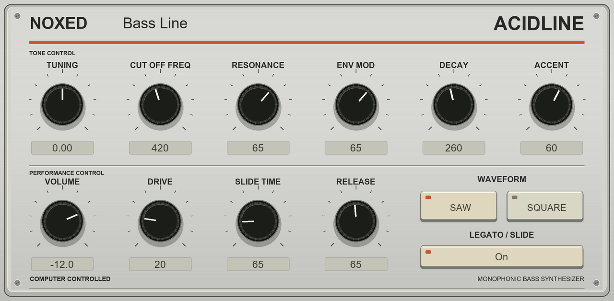
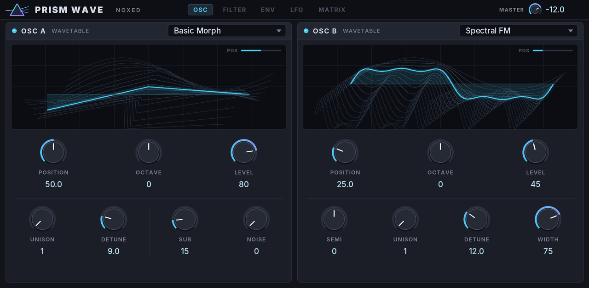

# NOXED MPC Plugins

Zwei eigenständige Instrumente für Akai MPC Standalone, gebaut mit dem
[inMusic MPC Plugin Builder SDK](https://github.com/inmusic-software/mpc-plugin-builder-sdk).

**Acidline 0.1.1 · Prism Wave 0.1.1.** Die Grundversionen wurden vom Auftraggeber auf seiner MPC ausprobiert. Die neuen Skins (Acidline silbern, Prism Wave dunkel) sind am Computer validiert; die Bedienung auf der MPC steht noch aus.





Vorschauen aus den echten Skin-Dateien und Reglergrafiken, kein Foto vom MPC-Bildschirm.
Weitere Prism-Wave-Seiten: [Filter/FX](docs/screenshots/prism-wave-filter.png) · [Envelopes](docs/screenshots/prism-wave-env.png) · [LFOs](docs/screenshots/prism-wave-lfo.png) · [Matrix](docs/screenshots/prism-wave-matrix.png).

## Instrumente

| Instrument | Funktionen |
| --- | --- |
| **Acidline** | Monophoner, TB-303-inspirierter Acid-Synth mit Saw/Square, nichtlinearem resonantem Filter, Velocity-Accent, Legato-Slide, Drive und sechs Presets. |
| **Prism Wave** | Eigenständiger, Serum-inspirierter Wavetable-Synth mit acht Stimmen, zwei Oszillatoren, je bis zu drei Unison-Stimmen, Sub/Noise, Filter, zwei ADSRs, zwei LFOs, vier Modulationsrouten, Chorus, Delay und acht Presets. |

Keine originalgetreue TB-303-Schaltungsemulation und keine vollständige Serum-2-Nachbildung.
Es sind keine proprietären Roland-/Xfer-Codebestandteile, Samples oder Presets enthalten.
Prism Wave hat keinen Serum-Presetimport, Sample-/Granular-Modus, MPE oder grafischen Wavetable-Editor.

## Download und Installation

Die fertigen Pakete und Hörbeispiele stehen unter **[Releases](../../releases)**.
Das aktuelle kombinierte Paket heißt `NOXED-MPC-Plugins-0.1.1.zip` und enthält Acidline 0.1.1 sowie Prism Wave 0.1.0. Prism Wave 0.1.1 (neuer Skin) liegt bisher nur als Quellcode vor; die ARM-Binaries dafür müssen noch gebaut werden.

1. ZIP am Computer entpacken.
2. Den enthaltenen Ordner `VST2 Plugins` ins Stammverzeichnis eines MPC-Datenträgers kopieren.
   Bei einem bestehenden Ordner nur die beiden NOXED-Unterordner ergänzen; deren Namen unverändert lassen.
3. **MPC OS 3.10.1 oder neuer** verwenden und unter Preferences → Enhancements (Beta)
   **Enable Enhancements** und **External Plugin Support** einschalten.
4. Bei Bedarf MPC neu starten und das Instrument unter **External Plugins** auswählen.

**Updates:** Den bisherigen Ordner `NOXED - VST - Acidline` bzw. `NOXED - VST - Prism Wave` durch 0.1.1 ersetzen und die MPC neu starten, damit der neue Skin geladen wird. Klang, Plugin-ID, Parameterzuordnung und Presets bleiben erhalten. Details im [Changelog](CHANGELOG.md).

ARM32- und ARM64-Binaries liegen bei; die MPC Live III verwendet ARM64.
Die Release-Binaries benötigen glibc ≥ 2.38; laut SDK verwendet MPC OS 3 glibc 2.39.

## Wavetable-Import

Prism Wave bietet acht User-Slots für WAV-Wavetables. User 01 enthält eine originale
NOXED-Demotabelle. Auf Windows 64 Bit kann das beiliegende `import_wavetable.exe`
ohne Python gestartet werden; für andere Systeme liegt `import_wavetable.py` bei.

Der Import wird **am Computer vorbereitet**, nicht über einen Dateidialog auf der MPC.
Er unterstützt zyklische Mono-/Stereo-PCM- oder Float32-WAVs mit bekannter Frame-Länge.
Das Werkzeug erzeugt 2048 Samples pro Frame und höchstens 64 Frames. Bei größeren
Tabellen bis 1024 Frames werden 64 gleichmäßig verteilte Frames ausgewählt.
Nach dem Kopieren alle Plugin-Instanzen neu laden.

**Projekte speichern Slotnummern, keine WAV-Audiodaten.** Die Content-Dateien mitsichern;
das Ersetzen eines Slots verändert den Klang bestehender Projekte.

Details: [Prism-Wave-Anleitung](plugins/Prism%20Wave/README.md) ·
[Acidline-Anleitung](plugins/Acidline/README.md) · [Installation](docs/NOXED-Anleitung.txt).

## Teststand

- Je Instrument 19 SDK-Hostprüfungen: keine Warnungen oder Fehler.
- 33 zusätzliche Audio-/Funktionstests, einschließlich aller Presets, Accent/Slide,
  Wavetable-Import und -Morphing, Modulationsmatrix, Sustain und Unison-Stresstest.
- Python-Importer: vier Tests; Windows-Importer: Import, Überschreibschutz,
  explizites Ersetzen und Ablehnung nicht endlicher Audiodaten geprüft.
- ARM32/ARM64-Paketvalidator: keine Fehler; je zwei Kompatibilitätshinweise zu glibc ≥ 2.38.

[Testzusammenfassung](tests/reports/summary.json) und vollständige Logs liegen bei.
Der [Skin-Testbericht für Prism Wave 0.1.1](tests/reports/prism-wave-0.1.1-skin-checks.txt) belegt Skin-Prüfung, 19 bestandene Hostprüfungen und bytegleiches Audio.
Der [Skin-Testbericht für Acidline 0.1.1](tests/reports/acidline-0.1.1-skin-checks.txt)
prüft alle 16 Parameterbindungen, Q-Link-Gruppen, PNG-Abmessungen und unveränderten Klang:
die gerenderte Audiodatei ist bytegleich mit der 0.1.0-Referenz.
Hardware-CPU, Ladezeit, Touch/Q-Link-Bedienung des neuen Skins und Projektwiederherstellung müssen auf
der MPC geprüft werden. Plugins laufen ohne Crashschutz in der MPC-Anwendung.

## Aus dem Quellcode bauen

Python 3.9+; der SDK-Builder lädt den Zig-Crosscompiler beim ersten Build herunter:

```sh
python tools/build.py plugins/Acidline
python tools/build.py "plugins/Prism Wave"
```

Anschließend mit dem SDK-Hostsimulator testen. Siehe [Build-Hinweise](NOXED-BUILD.md),
[SDK-Dokumentation](SDK-README.md) und [Testanleitung](docs/install-and-test.md).
Die Windows-Release-Builds wurden alternativ mit Arm GNU 15.2 und LLVM-MinGW erstellt;
`tools/build_noxed_windows.py` unterstützt diese vorkompilierten Toolchains.

## Lizenz und Herkunft

Originaler NOXED-Code und Demo-Wavetable: [MIT](NOXED-LICENSE.txt).
Das mitgelieferte SDK basiert auf inMusic-Revision `febd2ca` vom 7. November 2026,
ebenfalls [MIT](LICENSE). Runtime-Lizenzhinweise sind den Release-Paketen beigefügt.
Roland/TB-303 und Serum/Xfer sind Marken ihrer jeweiligen Inhaber. Keine Verbindung
zu oder Freigabe durch diese Hersteller; Drittanbieter-Plugins sind von inMusic nicht unterstützt.
