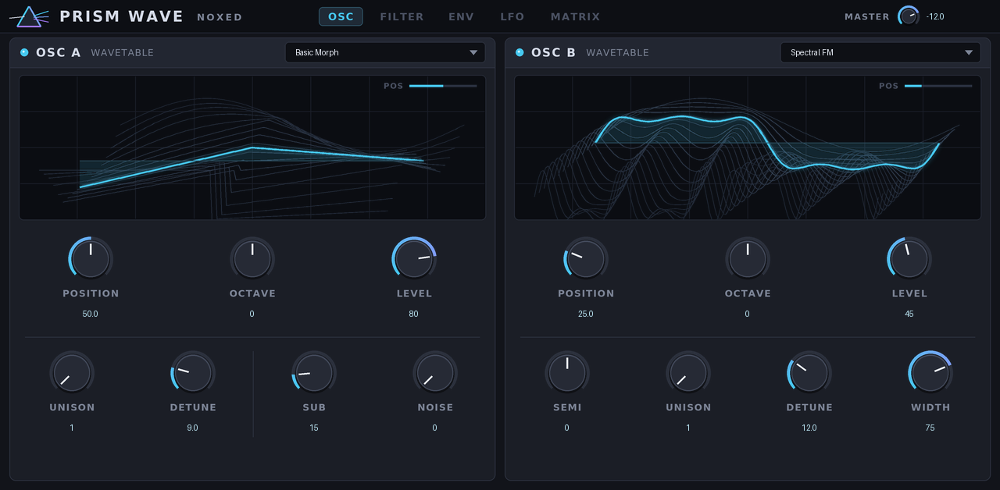

# NOXED MPC Plugins

[](https://github.com/molgino/noxed-mpc-plugins/actions/workflows/build-plugins.yml) [](https://ko-fi.com/noxend)

Open-Source-Plugins für Akai MPC Standalone (MPC Live/X/One/Key/Force, MPC OS 3.10.1+), gebaut mit dem
[inMusic MPC Plugin Builder SDK](https://github.com/inmusic-software/mpc-plugin-builder-sdk):
zwei Instrumente und drei Brücken zu externer Hardware. **Mitentwickeln ist ausdrücklich erwünscht**, siehe [Mitmachen](#mitmachen).

**Acidline 0.1.1 · Prism Wave 0.1.2 · MPC Overwitch 0.5.0 · MPC Overwitch Send 0.4.0 · MPC USB Bridge 0.2.1.**
Acidline, Prism Wave und MPC Overwitch wurden auf einer MPC Live III ausprobiert; die als *Vorschau* markierten Plugins sind noch nicht in allen Funktionen auf Hardware geprüft (Details in den jeweiligen READMEs).




Vorschauen aus den echten Skin-Dateien und Reglergrafiken, kein Foto vom MPC-Bildschirm.
Weitere Prism-Wave-Seiten: [Filter/FX](docs/screenshots/prism-wave-filter.png) · [Envelopes](docs/screenshots/prism-wave-env.png) · [LFOs](docs/screenshots/prism-wave-lfo.png) · [Matrix](docs/screenshots/prism-wave-matrix.png).

## Instrumente

| Instrument | Funktionen |
| --- | --- |
| **Acidline** | Monophoner, TB-303-inspirierter Acid-Synth mit Saw/Square, nichtlinearem resonantem Filter, Velocity-Accent, Legato-Slide, Drive und sechs Presets. |
| **Prism Wave** | Eigenständiger, Serum-inspirierter Wavetable-Synth mit acht Stimmen, zwei Oszillatoren, je bis zu drei Unison-Stimmen, Sub/Noise, Filter, zwei ADSRs, zwei LFOs, vier Modulationsrouten, Chorus, Delay und acht Presets. |
| **MPC Overwitch** *(Vorschau)* | Overbridge für Elektron-Geräte (getestet mit Digitone II) direkt in der MPC, auf Basis von Overwitch (GPL-3): Geräte-Spuren als Plugin-Spuren, bis zu 16 gleichzeitig, Gruppen aus mehreren Spuren, 48 → 44,1 kHz mit Drift-Ausgleich. [README](plugins/MPC%20Overwitch/README.md) |
| **MPC USB Bridge** *(Vorschau)* | Holt ein class-compliant USB-Audiogerät, das die MPC nicht als Interface nutzt (zuerst Roland S-1), als Plugin-Spur in die MPC, mit Drift-Ausgleich. Version 0.2, siehe [README](plugins/MPC%20USB%20Bridge/README.md). |
| **MPC Overwitch Send** *(Vorschau, Effekt)* | Schickt MPC-Spuren per Overbridge an die Eingänge des Elektron-Geräts (Digitone II: Main, Delay, Reverb, Chorus). [README](plugins/MPC%20Overwitch%20Send/README.md) |

Keine originalgetreue TB-303-Schaltungsemulation und keine vollständige Serum-2-Nachbildung.
Es sind keine proprietären Roland-/Xfer-Codebestandteile, Samples oder Presets enthalten.
Prism Wave hat keinen Serum-Presetimport, Sample-/Granular-Modus, MPE oder grafischen Wavetable-Editor.

## Download und Installation

Die fertigen Pakete stehen unter **[Releases](../../releases/latest)**: je Plugin ein ZIP (`<plugin>-<version>-mpc.zip`) und ein Gesamtpaket `NOXED-MPC-Plugins-<version>.zip`. Jeder Push baut die Plugins außerdem in [GitHub Actions](../../actions) (Downloads unter *Artifacts*).

1. ZIP am Computer entpacken.
2. Den enthaltenen Plugin-Ordner (`NOXED - VST - …`) in den Ordner `VST2 Plugins` im Stammverzeichnis eines MPC-Datenträgers kopieren (Ordner anlegen, falls es ihn nicht gibt). Ordnernamen unverändert lassen.
3. **MPC OS 3.10.1 oder neuer** verwenden und unter Preferences → Enhancements (Beta)
   **Enable Enhancements** und **External Plugin Support** einschalten.
4. MPC neu starten und das Plugin unter **External Plugins** auswählen.

**Updates:** Den bisherigen Plugin-Ordner ersetzen und die MPC neu starten. Plugin-IDs und Parameter bleiben erhalten, neue Parameter werden nur hinten angefügt. MPC Overwitch und MPC Overwitch Send immer zusammen aktualisieren. Details im [Changelog](CHANGELOG.md).

ARM32- und ARM64-Binaries liegen bei; die MPC Live III verwendet ARM64.
Die Release-Binaries benötigen glibc ≥ 2.38; laut SDK verwendet MPC OS 3 glibc 2.39.

## Wavetable-Import

Prism Wave bietet acht User-Slots für WAV-Wavetables. User 01 enthält eine originale
NOXED-Demotabelle. Auf Windows 64 Bit kann das beiliegende `import_wavetable.exe`
ohne Python gestartet werden; für andere Systeme liegt `import_wavetable.py` bei.

Der Import wird **am Computer vorbereitet**, nicht über einen Dateidialog auf der MPC.
Er unterstützt zyklische Mono-/Stereo-PCM- oder Float32-WAVs mit bekannter Frame-Länge.
Das Werkzeug erzeugt 2048 Samples pro Frame und höchstens 64 Frames. Bei größeren
Tabellen bis 1024 Frames werden 64 gleichmäßig verteilte Frames ausgewählt.
Nach dem Kopieren alle Plugin-Instanzen neu laden.

**Projekte speichern Slotnummern, keine WAV-Audiodaten.** Die Content-Dateien mitsichern;
das Ersetzen eines Slots verändert den Klang bestehender Projekte.

Details: [Prism-Wave-Anleitung](plugins/Prism%20Wave/README.md) ·
[Acidline-Anleitung](plugins/Acidline/README.md) · [Installation](docs/NOXED-Anleitung.txt).

## Teststand

- Je Instrument 19 SDK-Hostprüfungen: keine Warnungen oder Fehler.
- 33 zusätzliche Audio-/Funktionstests, einschließlich aller Presets, Accent/Slide,
  Wavetable-Import und -Morphing, Modulationsmatrix, Sustain und Unison-Stresstest.
- Python-Importer: vier Tests; Windows-Importer: Import, Überschreibschutz,
  explizites Ersetzen und Ablehnung nicht endlicher Audiodaten geprüft.
- ARM32/ARM64-Paketvalidator: keine Fehler; je zwei Kompatibilitätshinweise zu glibc ≥ 2.38.

[Testzusammenfassung](tests/reports/summary.json) und vollständige Logs liegen bei.
Der [Skin-Testbericht für Prism Wave 0.1.1](tests/reports/prism-wave-0.1.1-skin-checks.txt) belegt Skin-Prüfung, 19 bestandene Hostprüfungen und bytegleiches Audio.
Der [Skin-Testbericht für Acidline 0.1.1](tests/reports/acidline-0.1.1-skin-checks.txt)
prüft alle 16 Parameterbindungen, Q-Link-Gruppen, PNG-Abmessungen und unveränderten Klang:
die gerenderte Audiodatei ist bytegleich mit der 0.1.0-Referenz.
Hardware-CPU, Ladezeit, Touch/Q-Link-Bedienung des neuen Skins und Projektwiederherstellung müssen auf
der MPC geprüft werden. Plugins laufen ohne Crashschutz in der MPC-Anwendung.

## Aus dem Quellcode bauen

Python 3.9+; der SDK-Builder lädt den Zig-Crosscompiler beim ersten Build herunter:

```sh
python tools/build.py plugins/Acidline
python tools/build.py "plugins/Prism Wave"
python tools/build.py "plugins/MPC Overwitch"      # ebenso "MPC Overwitch Send", "MPC USB Bridge"
sh "plugins/MPC Overwitch/tests/run_tests.sh"      # Desktop-Tests ohne Hardware (aus dem Plugin-Ordner starten)
```

Anschließend mit dem SDK-Hostsimulator testen. Siehe [Build-Hinweise](NOXED-BUILD.md),
[SDK-Dokumentation](SDK-README.md) und [Testanleitung](docs/install-and-test.md).
Die Windows-Release-Builds wurden alternativ mit Arm GNU 15.2 und LLVM-MinGW erstellt;
`tools/build_noxed_windows.py` unterstützt diese vorkompilierten Toolchains.

## Mitmachen

Fehlerberichte, Ideen und Pull Requests sind willkommen. Wie es geht, steht in [CONTRIBUTING.md](CONTRIBUTING.md); kurz:

- **Fehler melden:** [Issue anlegen](../../issues/new/choose) mit MPC-Modell, MPC-OS-Version, Plugin-Version und am besten einem Foto der Statuszeilen.
- **Code beitragen:** Fork, Branch, `python tools/build.py "plugins/<Name>"` und den Host-Simulator grün bekommen, Pull Request gegen `main`. GitHub Actions baut und testet jeden Pull Request.
- **Ohne Programmieren helfen:** auf eigener Hardware testen (andere MPC-Modelle, andere Elektron- oder USB-Geräte) und berichten, was geht.

## Unterstützen

Die Plugins sind kostenlos und bleiben es. Wenn sie dir Zeit oder Geld sparen, freue ich mich über einen Kaffee:

[](https://ko-fi.com/noxend)

Genauso hilfreich: Fehler melden, auf eigener Hardware testen und weitersagen.

## Lizenz und Herkunft

| Teil | Lizenz |
| --- | --- |
| NOXED-Code: Acidline, Prism Wave, Werkzeuge, Skins, Demo-Wavetable | [MIT](NOXED-LICENSE.txt) |
| MPC Overwitch, MPC Overwitch Send, MPC USB Bridge (`plugins/MPC …`) | [GPL-3.0-or-later](plugins/MPC%20Overwitch/LICENSE) – nutzen die Gerätetabelle von [Overwitch](https://github.com/dagargo/overwitch) (GPL-3) |
| Mitgeliefertes SDK (inMusic-Revision `febd2ca` vom 7. November 2026) | [MIT](LICENSE) |

Runtime-Lizenzhinweise sind den Release-Paketen beigefügt.
Roland/TB-303/AIRA, Serum/Xfer, Elektron/Overbridge/Digitone und Akai/MPC sind Marken ihrer jeweiligen Inhaber. Keine Verbindung
zu oder Freigabe durch diese Hersteller; Drittanbieter-Plugins sind von inMusic nicht unterstützt.
