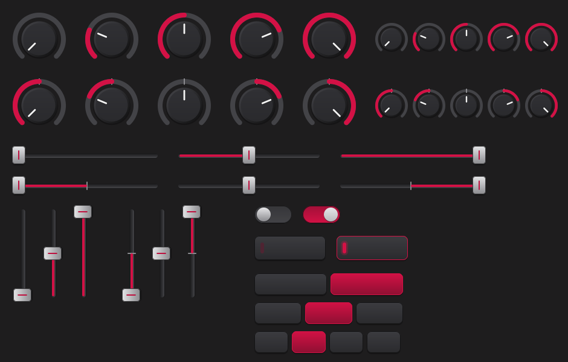

# UI kit: film-strip knobs, faders and switches

A themed set of control graphics for MPC plugin skins, drawn by `tools/make_ui_kit.py`
(standard-library Python, no image libraries). The pre-rendered default theme is in
`ui-kit/mpc-red/`; every other theme is rendered on demand. The assets are MIT-licensed with
the rest of the SDK and contain nothing from the MPC firmware.



Rows in the preview: unipolar knob, bipolar knob (each also at the small size), unipolar and
bipolar horizontal faders, vertical faders, the toggle, the LED push button and the 2-, 3- and
4-way segment buttons.

## The easy way: `ui.json`

`tools/gen_ui.py` uses the kit whenever a control asks for a `knob`, `fader` or `switch`
widget. Nothing needs copying; the build renders the theme once into `build/ui-kit-<theme>/`
and copies only the files the layout uses into `Plugin Skins/`.

```json
{
  "kit": "mpc-red",
  "pages": [
    { "name": "FILTER",
      "controls": [
        { "param": "Cutoff",     "widget": "knob" },
        { "param": "Resonance",  "widget": "knob" },
        { "param": "Mode",       "widget": "switch" },
        { "param": "Env Amount", "widget": "knob", "polarity": "bipolar" },
        { "param": "Attack",     "widget": "fader" },
        { "param": "Decay",      "widget": "fader" },
        { "param": "Sustain",    "widget": "fader" },
        { "param": "Release",    "widget": "fader" }
      ] }
  ]
}
```

| Widget | Drawn as | For |
|---|---|---|
| `knob` | 90 px film-strip knob, name and value to its right | most continuous parameters; bipolar ones get the centre-zero strip |
| `fader` | 248 px horizontal fader under a name / value header | levels, mix, amounts, envelope stages |
| `switch` | pill toggle for bool parameters; 2–4 segment buttons captioned with the choice names for choice parameters | on/off and short mode lists |
| `slider` | the MPC's generic name + value bar (no kit graphic) | long choice lists (with `"overlay": "menu"`), anything plain |

`"kit"` takes a theme name (`mpc-red`, `amber`, `cyan`, `lime`, `violet`, `mono`) or an
object: `{ "theme": "cyan" }`, `{ "accent": "ff19c6e0" }`. When any kit widget is used and
`"kit"` is absent, `mpc-red` is assumed. The focus ring (`style.accent`) follows the kit
colour unless you set it yourself.

`"polarity"` on a `knob` or `fader` is `"auto"` (default), `"unipolar"` or `"bipolar"`.
Auto draws the centre-zero strip when the parameter's default sits at the centre of its
range and reads as zero (`0`, `0.0 dB`, `+0 st`). A parameter such as an envelope amount
of -100..100 % with a default of 40 needs `"polarity": "bipolar"` spelled out.

See `docs/ui-guide.md` for the whole `ui.json` format and the design heuristics.

## Hand-written skins

Render a theme into your skin folder and reference the files from `TUI.json`:

```
python tools/make_ui_kit.py --out "plugins/<Name>/skins" --theme amber
python tools/make_ui_kit.py --list
```

The MPC draws film-strip frames and button images at their native pixel size (nothing is
scaled), so give each entry bounds at least as large as the asset. Film strips are vertical
with frame 0 (minimum) at the top; 127 frames puts the bipolar centre on frame 63.

| Asset | Size | Frames | Widget in TUI.json |
|---|---|---|---|
| `knob_uni.png`, `knob_bi.png` | 90 × 90 | 127 | `Knob`, `knobType: "FilmStrip"` |
| `knob_small_uni.png`, `knob_small_bi.png` | 56 × 56 | 127 | `Knob`, `knobType: "FilmStrip"` |
| `fader_h_uni.png`, `fader_h_bi.png` | 248 × 36 | 127 | `Knob`, `knobType: "FilmStrip"`, version 3, `dragOrientation: "Horizontal"` |
| `fader_v_uni.png`, `fader_v_bi.png` | 36 × 160 | 127 | `Knob`, `knobType: "FilmStrip"` (vertical drag, the default) |
| `toggle_on.png`, `toggle_off.png` | 64 × 32 | 1 | `Button`, `numButtonsInGroup: 1`, `buttonId: 1` |
| `button_on.png`, `button_off.png` | 120 × 44 | 1 | `Button`; put a `Label` on top for the caption |
| `seg2_*.png`, `seg3_*.png`, `seg4_*.png` | 122 / 80 / 58 × 40 | 1 | `Button` radio group (`numButtonsInGroup: n`, `buttonId: 0..n-1`) with a `Label` caption each |

A horizontal fader entry:

```json
{"version": 3, "knobType": "FilmStrip", "filmStrip": "fader_h_uni.png", "numFrames": 127, "invert": false, "dragOrientation": "Horizontal", "handleName": "Data"}
```

A toggle entry (lit when the bool is on):

```json
{"version": 2, "onImage": "toggle_on.png", "offImage": "toggle_off.png", "buttonId": 1, "numButtonsInGroup": 1, "handleName": "Data", "gestureBehaviour": "Instant"}
```

Labels do not intercept touches, so a caption `Label` can sit over a button. `kit.json` in
the rendered folder lists every asset's size and the theme colours, for layouts that want
to match them.

## Hardware notes

The widgets and versions used are the same ones the MPC's own skins use. Two details have not
yet been checked on hardware and are worth a look the first time you install a kit UI: how a
horizontal film-strip fader feels under a finger (it is a Knob widget dragged sideways), and
that the toggle responds only to touch, the Q-Link and the Enter menu (its `Instant` gesture
does not take the data wheel; switch to `"Hold"` in a hand-written skin if you want that).

## Regenerating the default theme

```
python tools/make_ui_kit.py --out ui-kit/mpc-red --preview ui-kit/preview.png
```

Rendering a kit takes about five seconds. Edit the colours in `GREYS` / `THEMES` or the
drawing code in `tools/make_ui_kit.py` and bump `KIT_VERSION` so cached builds re-render.
